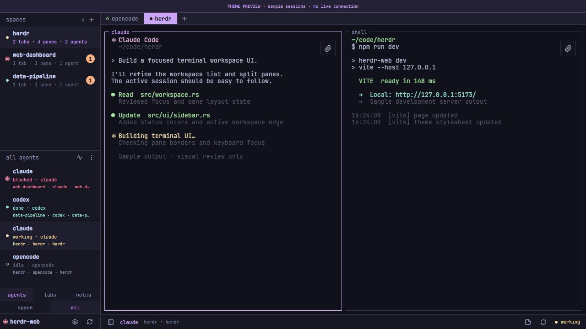

# Herdr Web TUI

Веб-клиент для Herdr с темой по образцу интерактивной оболочки на [herdr.dev](https://herdr.dev/): моноширинный интерфейс, панели spaces/agents, компактные вкладки и рамки терминалов.

Основан на [kcosr/herdr-web](https://github.com/kcosr/herdr-web), исходный коммит `f1312e2ffbe8d5b62db57ced66c3c56c4cdebdfb`. История Git и [лицензия MIT](LICENSE) сохранены. Это независимый форк; он не является официальным продуктом Herdr. Развитие проекта самостоятельное: исходный herdr-web — только источник идей, его обновления не накатываются поверх.

Тема работает в браузере и подключается к настоящим сессиям через `herdr-web-bridge`. Сам Herdr устанавливается отдельно; его терминальный интерфейс этот проект не изменяет.



На изображении тестовые сессии. В рабочем интерфейсе отображаются ваши пространства, агенты и терминалы.

## Требования

- Работающий Herdr с терминальным протоколом **22**. Upstream указывает Herdr 0.9.0+; этот форк проверен с **Herdr 0.9.5** по протоколу 22 на Linux (28.10.2026; вендор-снимок совместимости обновлён до v0.9.5, 146 тестов) и ранее с **Herdr 0.9.1** на Windows. Более новая версия Herdr должна сохранять совместимость с протоколом 22.
- Git, **Node.js 24.x** и npm (проверено с Node.js 24.15).
- Rust stable и системный C/C++ toolchain: например, `build-essential` на Debian/Ubuntu или Visual Studio Build Tools с компонентами C++ на Windows.
- Для первоначальной установки зависимостей нужен доступ к npm и crates.io.

## Установка на Linux

Запускайте bridge от того же пользователя, у которого работает Herdr. Установите перечисленные выше зависимости, запустите Herdr, затем:

```bash
git clone https://github.com/AlexanderGal86/herdr-web-tui.git
cd herdr-web-tui
npm ci --prefix web
npm run build
HOST=127.0.0.1 PORT=8787 bash scripts/run-bridge.sh
```

Откройте [http://127.0.0.1:8787](http://127.0.0.1:8787). Оставьте процесс работающим; `Ctrl+C` останавливает веб-клиент, не Herdr.

Скрипт выбирает `${XDG_CONFIG_HOME:-$HOME/.config}/herdr/herdr.sock`. Если Herdr использует другой сокет, укажите фактический путь:

```bash
HERDR_SOCKET_PATH=/path/to/herdr.sock \
  HOST=127.0.0.1 PORT=8787 bash scripts/run-bridge.sh
```

Публичный репозиторий: https://github.com/AlexanderGal86/herdr-web-tui. Внутреннее зеркало OneDev (`http://10.0.109.128:6610/herdr-web-tui.git`) доступно только из локальной сети/VPN и требует учётную запись.

### Если Linux — удалённый сервер

Запустите bridge на Linux по инструкции выше. На компьютере, где будете открывать браузер, создайте туннель (замените `user@server` своим SSH-адресом):

```bash
ssh -N -L 8788:127.0.0.1:8787 user@server
```

Откройте [http://127.0.0.1:8788](http://127.0.0.1:8788) на своём компьютере. Туннель должен оставаться запущенным. Bridge предоставляет управление терминалами и не имеет полноценной браузерной аутентификации, поэтому инструкции оставляют его на loopback.

## Установка на Windows

Запустите Herdr и выполните в PowerShell:

```powershell
git clone https://github.com/AlexanderGal86/herdr-web-tui.git
cd herdr-web-tui
npm ci --prefix web
npm run build
.\scripts\start-tui.ps1
```

Откройте [http://127.0.0.1:8787](http://127.0.0.1:8787). Скрипт использует `%APPDATA%\herdr\herdr.sock` и поддерживает другой порт:

```powershell
.\scripts\start-tui.ps1 -Port 8788
```

Для нестандартного сокета задайте `$env:HERDR_SOCKET_PATH` перед запуском. Для именованной сессии сначала явно задайте каталог конфигурации: совместимый bridge сам не выбирает `%APPDATA%`.

```powershell
$env:HERDR_CONFIG_DIR = Join-Path $env:APPDATA 'herdr'
.\scripts\start-tui.ps1 -Session NAME
```

Замените `NAME` именем существующей сессии. Если ваш Herdr хранит конфигурацию в другом каталоге, укажите его. При явном выборе сессии bridge игнорирует `HERDR_SOCKET_PATH`.

Если политика PowerShell запрещает локальные скрипты, можно запустить bridge напрямую, не меняя политику:

```powershell
$env:HERDR_SOCKET_PATH = Join-Path $env:APPDATA 'herdr\herdr.sock'
.\bridge\target\debug\herdr-web-bridge.exe --host 127.0.0.1 --port 8787 --static-dir web/dist
```

## HTTPS (TLS)

Добавьте флаг `--tls-self-signed` — тот же порт начнёт отдавать HTTPS и `wss://`
вместо HTTP и `ws://` (протокол без флага не меняется):

```bash
./bridge/target/release/herdr-web-bridge --host 0.0.0.0 --port 8787 \
  --static-dir web/dist --tls-self-signed
```

Самоподписанный сертификат генерируется при первом запуске и хранится в
`~/.local/state/herdr-web/tls` (переопределяется переменной `HERDR_WEB_TLS_DIR`),
покрывает `localhost`, `127.0.0.1`, `::1`, имя машины и локальные IP. Сертификат
стабилен между перезапусками — браузеру достаточно принять его один раз (при
смене fingerprint мост печатает SHA-256 в stderr при старте — TOFU). В
systemd-юнитах с нестандартным `HOME` задайте `HERDR_WEB_TLS_DIR` явно.

## Выбор темы

**Settings → Display → Appearance:**

- **Herdr TUI** — новая тема, включена по умолчанию.
- **Web** — исходное оформление herdr-web.

Выбор сохраняется в браузере отдельно для каждого адреса и порта. Сохраняются настоящие терминалы, вкладки, разделение панелей, переключение пространств и остальные функции исходного клиента.

## Меню терминала

Нажмите правую кнопку мыши внутри терминала: появятся переименование и сброс имени, перестановка с активной панелью, разделение вправо/вниз, вставка из буфера обмена (Paste), восстановление обычного макета вкладки — только когда вкладка уже приближена, — и закрытие с подтверждением. Отдельного пункта Zoom в меню больше нет; существующее состояние Zoom остаётся восстановимым. Меню работает в обеих темах и действует на панель под курсором. Недоступные bridge команды скрываются.

Клавиатура: **Shift+F10** или клавиша контекстного меню. Пункт **Send right-clicks to pane** передаёт ПКМ терминальной программе. Чтобы вернуть меню, нажмите **Shift+ПКМ** и выберите **Use Herdr right-click menu**. Переключатель действует только в текущем веб-клиенте для этой панели и сбрасывается после перезагрузки страницы; настройку native Herdr он не меняет.

Для перестановки панелей и восстановления макета после Zoom нужен обновлённый bridge из этого репозитория: одной замены `web/dist` на старом bridge недостаточно.

## Копирование и вставка

Выделение текста мышью больше не копируется автоматически: выделение лишь выделяет, а копирование выполняется явными действиями — правый клик по выделению копирует текст и снимает выделение (Shift+правый клик всегда открывает меню терминала), либо копирование с клавиатуры, либо мобильный диалог копирования. Двойной щелчок выделяет слово. Нажатие колёсика вставляет текст из буфера в панель под курсором и делает её активной; то же делает пункт «Paste» в меню терминала. Переносы строк сохраняются; если программа поддерживает bracketed paste, используется этот режим.

Для вставки колёсиком браузеру нужен доступ к чтению буфера: используйте HTTPS или localhost (в том числе SSH-туннель). На обычном HTTP-адресе Linux-сервера этот API может быть недоступен. При отказе появится сообщение; можно воспользоваться стандартной вставкой с клавиатуры. Мобильное выделение и меню ПКМ сохраняются.

## TTT-редактор

Кнопка **Open TTT** в правом нижнем углу открывает [TTT Editor](https://tttedit.dev) новой вкладкой в активном пространстве — через официальный механизм панелей плагинов Herdr (`ttt.editor`), поэтому панель получает родную маршрутизацию правого клика и разрешение каталога плагина. Кнопка появляется, только когда плагин установлен и включён на хосте bridge (`herdr plugin install eugenioenko/ttt/herdr-plugin`); на сохранённых SSH-машинах она скрыта, потому что запуск всегда идёт на хосте bridge.

События мыши пересылаются терминальной программе только в панелях с включённым пунктом **Send right-clicks to pane** (например, TTT): bridge передаёт состояние захвата мыши от демона, и Клиент пересылает структурированные события в панель, где демон кодирует их в формате, который запросило приложение. Во всех остальных панелях (в том числе когда приложение само включает отслеживание мыши — pi, vim, htop) мышь остаётся полностью браузерной: перетаскивание выделяет текст, правый клик копирует/открывает меню, колесо листает историю. **Shift+правый клик** всегда открывает меню Herdr, а вставка колёсиком работает, только когда панель не пересылает мышь.

## Если herdr-web уже установлен

Соберите только интерфейс:

```bash
npm ci --prefix web
npm run build:web
```

Перенесите `web/dist` **целиком** в отдельный каталог рядом с существующим bridge и укажите этот каталог в его параметре `--static-dir`. Не нужно копировать `node_modules` или Windows-файл `.exe` на Linux. Этот способ требует совместимого API bridge; надёжный вариант — использовать bridge и frontend из одного коммита этого репозитория.

## Обновление

Остановите процесс bridge (`Ctrl+C`), затем из чистой рабочей копии:

```bash
git pull --ff-only
npm ci --prefix web
npm run build
```

Снова выполните команду запуска для своей ОС и обновите страницу браузера. Сессии Herdr при этом продолжают работать. Локальные изменения сначала сохраните в отдельной ветке; не используйте принудительный сброс для обновления.

## Разработка и проверки

На Linux сервер разработки и bridge вместе запускаются командой `npm run dev`, адрес [http://127.0.0.1:5173](http://127.0.0.1:5173).

На Windows штатный объединённый launcher несовместим с запуском `npm.cmd` через Node.js. После сборки откройте два PowerShell-терминала в каталоге проекта: в первом выполните `.\scripts\start-tui.ps1`, во втором — `npm run dev:web`. Vite на 5173 проксирует API и WebSocket на bridge 8787.

Демонстрация без запущенного Herdr:

```bash
npm run dev:web
```

Откройте [http://127.0.0.1:5173/theme-preview.html](http://127.0.0.1:5173/theme-preview.html). Это изолированные тестовые данные; команды в реальные терминалы не отправляются. Страница предпросмотра не входит в production-сборку.

Основные проверки frontend:

```bash
npm run lint:web
npm run test:web
npm run build:web
```

Полный набор upstream-проверок: `npm run check` (нужны Bash и ripgrep, помимо Node.js и Rust). На Windows у исходного проекта есть известные ошибки в Rust-тестах файловых операций и в тестах Unix-скриптов. **Полный набор не заявлен как прошедший.** Детали, дата и результаты проверок находятся в [технической документации темы](docs/herdr-tui.md). Работа форка на Linux проверена 28.10.2026: линтер, все 506 frontend-тестов (56 файлов), 237 тестов bridge (ещё 1 игнорируется), 146 тестов вендор-крейта совместимости, форматирование Rust, `tsc -b`, отладочная сборка и изолированная production-сборка Vite — всё без ошибок. Исторические результаты на Windows сохранены ниже по тексту и в [технической документации](docs/herdr-tui.md); сохранённые SSH-машины, зоны Local/Remote и загрузки на удалённые машины описаны в [docs/native-machines-and-uploads.md](docs/native-machines-and-uploads.md).

## Добавление машин (Farm)

Кнопка «+» в заголовке секции боковой панели открывается, когда bridge обслуживает capability `machines` (в ответе `/api/capabilities`) — в том числе до первой сохранённой машины и при выключенных зонах Local/Remote. Диалог «Add machine» принимает SSH-адрес (например, `root@10.0.0.220`), необязательные имя машины и имя удалённой сессии. Отправка формы запускает на хосте bridge штатную команду `herdr machine add` (обычный argv-вызов): регистрация следует документированному сценарию CLI — он может обнаружить и запустить удалённый сервер Herdr и сохраняет профиль, используя уже настроенный SSH-доступ хоста bridge. Сам bridge ничего не хранит и не добавляет SSH-ключей: аутентификация и проверка host-ключей остаются в OpenSSH, а шаги, зарезервированные CLI под интерактивное подтверждение (установка или замена удалённого сервера), не выполняются — команда завершается с текстом ошибки CLI. При перемещённом каталоге машин (`HERDR_WEB_MACHINES_ENDPOINTS`) маршрут отказывает с 503 ДО запуска CLI: CLI писал бы в иной каталог, чем тот, что обслуживает bridge, — машины в этом режиме добавляются только через CLI. Невалидные значения отклоняются до запуска; новая машина появляется в дереве сразу. Маршрут: `POST /api/machines/add`, защищён стандартной политикой запросов bridge.

## Отключение сохранённых машин

Правый клик по имени группы сохранённой машины в боковой панели открывает меню с пунктом «Disable connection». После подтверждения bridge вызывает новый маршрут `POST /api/machines/{machine_id}/disable`, который запускает на хосте bridge штатную команду `herdr machine disable <PROFILE_ID>` (обычный argv-вызов): сам bridge ничего не правит в `endpoints.json`, не трогает SSH-ключи и доверие хостам. Профиль сохраняется — отключённая машина исчезает из списка и маршрутов (они и так отказывают для отключённых записей), а повторное включение остаётся операцией нативного CLI на хосте bridge (`herdr machine enable`). Локальная машина (`local`), уже отключённые и неизвестные идентификаторы отказываются с внятной ошибкой, сбой CLI возвращается как 502 с его текстом, а при перемещённом каталоге машин (`HERDR_WEB_MACHINES_ENDPOINTS`) маршрут отказывает с 503 ДО запуска CLI. Маршрут защищён той же политикой Origin/Host, что и остальные маршруты; поведение получают все клиенты bridge после развёртывания собранного из этого исходника bridge — само обновление в эту задачу не входит.

## Документация

- [Устройство темы, исследование образца и результаты проверок](docs/herdr-tui.md).
- [Сохранённые SSH-машины, зоны Local/Remote и загрузки на удалённые машины](docs/native-machines-and-uploads.md).
- [Решение проблем подключения и запуска](docs/troubleshooting.ru.md).
- [Исходный README herdr-web](README.upstream.md).
- [Упаковка desktop-сборок](docs/packaging.md), [Android](docs/android.md), [совместимость с Herdr](docs/vendoring.md).

Сгенерированные сборки, зависимости, локальные заметки и закрепления агентов исключены из Git. Установка из репозитория собирает приложение из исходного кода; готовые Linux-бинарники в репозиторий не включены.
